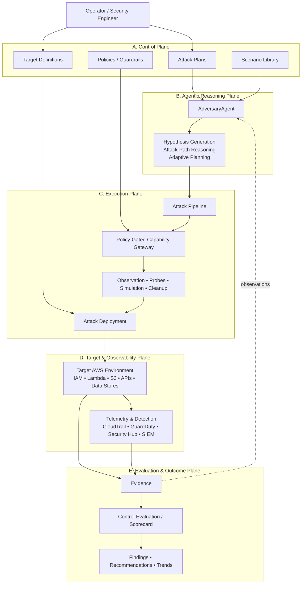

# AttackYourself Reference Architecture

AttackYourself is a policy-bounded, agentic security-validation system designed
to execute authorised adversarial scenarios against cloud environments and
evaluate how effectively those environments prevent, detect, contain, and
recover from them.

The architecture is intentionally described in AttackYourself concepts rather
than in terms of a particular agent framework or AWS service. AgentCore is one
reference implementation of several responsibilities; it is not the product
story itself.

The core control loop is:

```text
Reason -> Validate -> Authorise -> Execute -> Observe -> Evaluate
```

The central rule is that **reasoning is not authority**. An agent may form
hypotheses, select among permitted attack paths, and adapt its approach, but
infrastructure-affecting actions are performed only through explicitly exposed,
policy-controlled capabilities.

## Core domain concepts

### Attack Plan

An **Attack Plan** is a reusable definition of a security objective and the
conditions under which it may be tested.

An Attack Plan can describe:

- the security objective or hypothesis
- prerequisites and target characteristics
- candidate attack techniques
- expected preventive and detective controls
- evidence requirements
- stop conditions
- cleanup requirements
- mappings to frameworks such as MITRE ATT&CK

An Attack Plan describes **what should be tested** without necessarily binding
the test to a particular AWS account, region, or concrete resource.

### Attack Pipeline

An **Attack Pipeline** is the executable adversarial workflow derived from an
Attack Plan.

A pipeline combines deterministic orchestration with bounded agentic reasoning.
Some transitions may be fixed, while others may depend on evidence collected
during execution.

```text
Discover target
      |
      v
Validate prerequisites
      |
      v
Form attack hypothesis
      |
      v
Select permitted probe
      |
      v
Policy evaluation
      |
      v
Execute
      |
      v
Observe result
      |
      v
Adapt or continue
      |
      v
Collect evidence
      |
      v
Evaluate
      |
      v
Cleanup
```

The pipeline defines the possible execution graph. The reasoning plane may
navigate that graph and choose among allowed branches, but it does not gain
authority outside the capabilities exposed by the execution plane.

An Attack Pipeline is therefore neither a completely fixed CI-style script nor
an unrestricted autonomous agent. It is a bounded adversarial workflow whose
adaptive parts operate inside deterministic constraints.

### Attack Deployment

An **Attack Deployment** is a concrete execution of an Attack Pipeline against
an explicitly authorised target environment.

A deployment binds the reusable pipeline to operational context such as:

- AWS account and region
- target resources
- resource tags or scope selectors
- policy set and guardrails
- execution limits
- credentials and roles
- deployment or run identifier
- start and termination conditions
- cleanup expectations

The relationship is:

```text
Attack Plan
    |
    v
Attack Pipeline
    |
    v
Attack Deployment
```

Or, in product terms:

```text
Reusable intent -> Executable adversarial workflow -> Authorised execution
```

## Architectural planes

### A. Control Plane

The Control Plane defines **what may happen and where**.

Responsibilities include:

- operator / security engineer interaction
- Attack Plans
- scenario library
- target definitions
- policies and guardrails
- deployment constraints
- approvals where required
- blast-radius limits
- stop conditions

The Control Plane establishes the authorised envelope within which agentic
behaviour can occur.

### B. Agentic Reasoning Plane

The Agentic Reasoning Plane determines **what to try next**.

Responsibilities include:

- attack hypothesis generation
- attack-path reasoning
- interpretation of observations
- next-action selection
- adaptation to previous results
- reasoning over available capabilities and evidence

The reasoning plane should not receive unrestricted cloud privileges. Its
freedom is cognitive: it may reason broadly, but it may act only through
capabilities made available by the execution plane.

### C. Execution Plane

The Execution Plane is where adversarial intent becomes controlled action.

Responsibilities include:

- Attack Pipeline orchestration
- policy enforcement
- capability gateways
- observation tools
- attack probes
- simulation capabilities
- cleanup actions
- Attack Deployment lifecycle management

Every infrastructure-affecting action should pass through a capability with a
defined contract, validated inputs, least-privilege identity, and auditable
result.

Generic shell access, unrestricted AWS SDK access, or equivalent broad
capabilities should not form the normal attack-tool vocabulary.

### D. Target & Observability Plane

The Target & Observability Plane contains both the systems under test and the
security controls expected to prevent, detect, or record adversarial activity.

Targets may include IAM identities and policies, Lambda and compute workloads,
S3 and other storage, APIs, databases and data stores, application services,
and cross-account trust relationships.

Observability may include CloudTrail, GuardDuty, Security Hub, CloudWatch,
application telemetry, SIEM platforms, alerting, and response systems.

This plane produces the evidence required to determine what actually happened,
rather than what the agent expected to happen.

### E. Evaluation & Outcome Plane

The Evaluation & Outcome Plane converts execution evidence into security
findings.

It evaluates questions such as:

- Was the attempted action prevented?
- If not, was it detected?
- How quickly was it detected?
- Was the signal actionable?
- Was the activity contained?
- Was sufficient forensic evidence produced?
- Could the environment recover cleanly?
- Did cleanup restore the intended state?

Outputs may include execution evidence, control-effectiveness assessments,
scenario scorecards, findings, remediation recommendations, historical
comparisons, and threat-framework mappings.

AttackYourself therefore treats security validation as an evidence-backed
feedback loop rather than a single opaque security score.

## Reference architecture



The dotted feedback path is deliberate. AttackYourself is not intended to be a
one-way flow of `LLM -> attack -> report`. Observations and evidence may inform
subsequent reasoning, but any new action must still return through policy and
execution controls.

## Trust boundary

The most important boundary is between **reasoning** and **action**.

```text
AI proposes
    |
    v
Domain validates
    |
    v
Policy authorises
    |
    v
Tool executes
    |
    v
Observability records
    |
    v
Evaluation interprets evidence
```

The model is allowed to be uncertain, exploratory, or creative in the reasoning
plane. Those properties must not automatically transfer into the authority
plane.

For active simulations, a mature deployment should additionally constrain:

- target accounts and regions
- resources by tags or explicit identifiers
- allowed APIs and operations
- time and cost budgets
- concurrency and blast radius
- destructive operations
- cleanup guarantees
- emergency stop or kill-switch behaviour

## Current implementation mapping

The current repository implements a small but real subset of this architecture:

```text
Operator
   |
   v
AdversaryAgent on AgentCore Runtime
   |
   v
Bedrock model
   |
   v
MCP client
   |
   v
AttackGateway
   |
   v
SimulationEnvironment Lambda
   |
   v
Structured environment observation
   |
   v
Agent interpretation and response
```

This proves the deployed runtime, reasoning, gateway, constrained tool, and
observation circuit.

It should **not** be read as evidence that the following are already complete:

- reusable Attack Plan schemas
- Attack Pipeline orchestration
- Attack Deployment lifecycle
- policy enforcement for active attack actions
- real target discovery beyond the current simulated description
- telemetry correlation
- evidence-backed scorecards
- adaptive multi-step adversarial campaigns

## Technology mapping

AttackYourself concepts should remain independent of a single implementation
platform. In the current reference implementation, several responsibilities map
naturally to AgentCore:

| AttackYourself responsibility | Current or candidate implementation |
| --- | --- |
| Hosted adversarial agent | AgentCore Runtime + Strands |
| Model reasoning | Amazon Bedrock |
| Capability exposure | AgentCore Gateway / MCP |
| Narrow tool implementation | Lambda |
| Policy-gated capability access | AgentCore Policy Engine / Cedar |
| Runtime observability | AgentCore logs/traces plus AWS telemetry |
| Evaluation experiments | AgentCore evaluators where appropriate |

Other deployments may implement the same architectural responsibilities using
different infrastructure. The AttackYourself domain model should not depend on
that choice.
